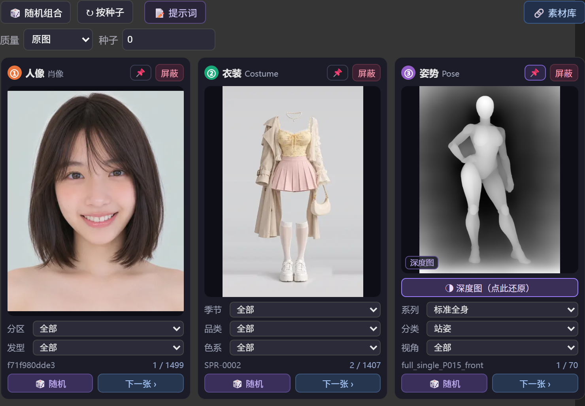
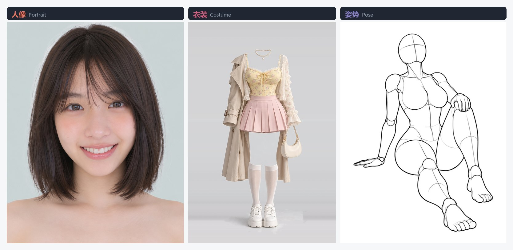
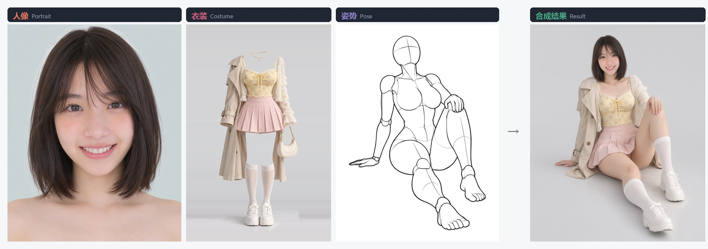
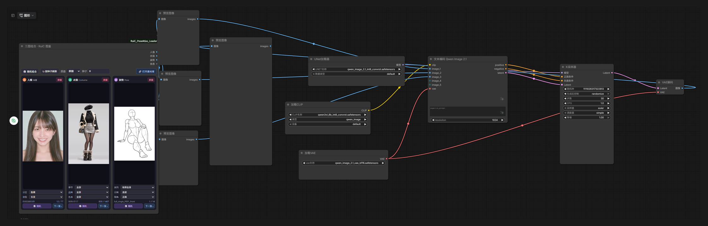

# ComfyUI RuiC PoseAtlas

把 [RuiC-PoseAtlas](https://github.com/HRuiCcc/RuiC-PoseAtlas) 素材库接成 ComfyUI 节点：一个节点同时输出**人像 / 衣装 / 姿势**三张参考图，适合喂给 Qwen-Image-Edit 这类多图编辑模型做「换人 + 换衣 + 摆姿势」。

带完整的可视化前端：三张卡片实时预览、单类随机、逐张翻页、子分类筛选、一键屏蔽。



一个节点输出的三张素材，分别对应「是谁」「穿什么」「什么姿势」：



三张图直接喂给 Qwen-Image-Edit 2.1，一次合成成品——脸来自第一张、衣服来自第二张、姿势来自第三张：



## 工作流接法



两个要点，接错会静默失败、不报错：

1. **`CLIPLoader` 的 type 必须选 `qwen_image`**。选 `stable_diffusion` 等其它值会自动回退到通用 Qwen3-VL tokenizer，丢掉参考图的 `<imageN>` 标记和 `image_slots` 位置信息，模型收不到三张参考图，结果完全失控。
2. **`KSampler` 的 latent 接 `TextEncodeQwenImage21` 的第 3 个输出 `latent`**，不要用 `EmptyLatentImage`。该 latent 是 64 通道、按第一张参考图尺寸生成，换成别的尺寸会让编辑发生偏移。

## 特性

- **三类素材一次取齐**：人像、衣装、姿势各输出一张 `IMAGE`，另附一个 `STRING` 说明当前选中的素材 ID。
- **两种选图方式并存**：按种子确定性选取（可复现），或在卡片上手动锁定某一张。
- **前端卡片面板**：每类一张卡片，含预览、子分类下拉、`🎲 随机`、`下一张 ›`、进度 `12 / 177`、`屏蔽` 按钮。面板随节点拖拽自动伸缩。
- **预览即出图**：前端锁定哪张，后端就出哪张，不会出现「预览和出图不一致」。
- **国内可直连**：不走 GitHub Pages 单点，内置 jsDelivr 等多条 CDN 线路，直连失败自动切代理，全部失败时用本地缓存兜底。
- **缓存加速**：素材索引和图片缓存在插件目录 `.cache/`，第二次起明显变快，可随时删除。

## 安装

### 方式一：ComfyUI Manager（推荐）

在 Manager 的 **Install via Git URL** 中填入本仓库地址：

```
https://github.com/shutong-queyue/ComfyUI-RuiC-PoseAtlas
```

### 方式二：手动

```bash
cd ComfyUI/custom_nodes
git clone https://github.com/shutong-queyue/ComfyUI-RuiC-PoseAtlas.git
```

重启 ComfyUI，在节点列表里搜 **三图组合** 或 **RuiC**。

依赖只有 `pillow` 和 `numpy`，ComfyUI 环境通常已自带。

## 使用

节点位于 `RuiC/三图组合` 分类，完整名称「三图组合 · RuiC 图鉴」。

### 输入参数

| 参数 | 说明 |
|---|---|
| 质量 | **在节点顶栏下拉选择**，默认 `原图`，输出素材真实分辨率（如人像 1122×1402、衣装 1366×2048、姿势 900×1200）；`缩略图` 仅约 400×500，只建议拿来快速试参 |
| 随机种子 | 关闭「每次随机」时，按此值确定性选图，同一种子结果固定 |
| 每次随机 | 开启后每次排队都重新抽样（与前端「随机组合」按钮等价） |
| 启用_人像 / 衣装 / 姿势 | 关闭即「屏蔽」该类，该路输出 1×1 占位图，不参与后续计算 |
| 人像_选定ID / 衣装_选定ID / 姿势_选定ID | 留空 = 按筛选 + 种子选取；填入 ID 则强制锁定该图。前端点卡片会自动写入 |
| 人像_分区 / 人像_发型 | 人像子分类筛选 |
| 衣装_季节 / 衣装_品类 / 衣装_色系 | 衣装子分类筛选 |
| 姿势_系列 / 姿势_分类 / 姿势_视角 | 姿势子分类筛选 |

### 输出

| 端口 | 类型 | 说明 |
|---|---|---|
| 人像 | IMAGE | 人像参考图 |
| 衣装 | IMAGE | 衣装参考图 |
| 姿势 | IMAGE | 姿势参考图 |
| 信息 | STRING | 三张图的 ID 与名称，便于记录 |

### 前端面板操作

节点上的原生参数控件被卡片面板接管并隐藏，因此**质量、种子、屏蔽开关、子分类筛选都在面板里操作**：

- `质量` / `种子`：顶栏的两个控件，等价于隐藏的原生参数。改质量即切换原图/缩略图输出，改种子即切换按种子选图的组合。
- `🎲 随机`：在当前所选子分类范围内，只随机这一类，不动另外两类。
- `下一张 ›`：跳到同维度下一张，到底回绕，进度显示 `当前 / 总数`。
- `屏蔽`：该类别不出图，进度显示 `—`。
- `🔗 打开素材库`：在浏览器打开上游素材库，方便先挑素材。
- `随机组合` / `按种子刷新`：前者不可复现，后者按「随机种子」数值确定性取图，可复现。

## 配合 Qwen-Image 2.1 使用的正确接法

这是实测踩过的坑，写法正确与否差别极大：

1. **CLIPLoader 的类型必须选 `qwen_image`**。若选 `stable_diffusion` 等其它值，ComfyUI 会静默回退到通用 Qwen3-VL tokenizer，丢失参考图的 `<imageN>` 标记与 `image_slots` 位置信息，模型收不到三张参考图，结果是「完全失控」且不报错。
2. **KSampler 的 latent 必须接 `TextEncodeQwenImage21` 的 `latent` 输出**，不要自己接 `EmptyLatentImage`。该节点的 latent 按**第一张参考图**的尺寸生成且为 64 通道，官方说明任何其它尺寸都会让编辑结果偏移。
3. 出图尺寸由「人像」这张图的比例决定。想要别的比例，在人像出口插入 `ImageScale`（设目标宽高、crop 选 center）即可，latent 会自动跟随。
4. cfg = 1.0 时 `negative_prompt` 不生效；需要负面词约束请把 cfg 提到 2.0 以上。

参考提示词：

```
保留图 1 人物完整面部特征、脸型、五官、发型与肤色，给这个人穿上图 2 里的整套服装，
服装的版型、面料纹理、配色、装饰细节原样保留；人物严格采用图 3 的全身姿势、肢体角度、
手部动作，不要改动肢体结构。统一光影自然，人体结构正确，五官不变形，同一个人，
不要生成新面孔，服装贴合身体，姿势和参考一致。
```

## 缓存与离线

- 索引 JSON 与图片存放于 `插件目录/.cache/`，索引有效期 7 天。
- 缓存目录可随时删除，下次运行会自动重建。
- 若所在网络完全无法访问素材站，插件会给出明确日志并以 1×1 占位图收场，不会让整个工作流报错中断。

## 常见问题

**出图全是 1×1？**
看控制台日志：如果提示「素材池为空」，是索引没拉到，检查网络后重启 ComfyUI；如果提示「选定ID未找到」，是前端锁定的 ID 来自更新的素材库版本，重启后端刷新缓存即可。

**出图尺寸只有 400×500 左右？**
「质量」被设成了 `缩略图`。切回 `原图` 即可。节点输出的 `信息` 端口会写明每张图的实际像素尺寸，可直接核对。

**卡片面板不显示 / 不随节点缩放？**
浏览器硬刷新（Ctrl+F5）一次，确保加载到最新前端脚本。

**预览图和实际出图不一致？**
正常情况不会。若出现，多半是改完素材库后没重启，重启 ComfyUI 后缓存与新索引会对齐。

## 素材来源与授权

本仓库**只包含加载器代码，不包含任何图片素材**。素材由 [HRuiCcc/RuiC-PoseAtlas](https://github.com/HRuiCcc/RuiC-PoseAtlas) 提供，版权归原作者所有，使用时请遵守该仓库的条款。若上游地址或授权发生变化，本插件可能需要相应调整。

插件代码以 MIT 协议开源，详见 `LICENSE`。
