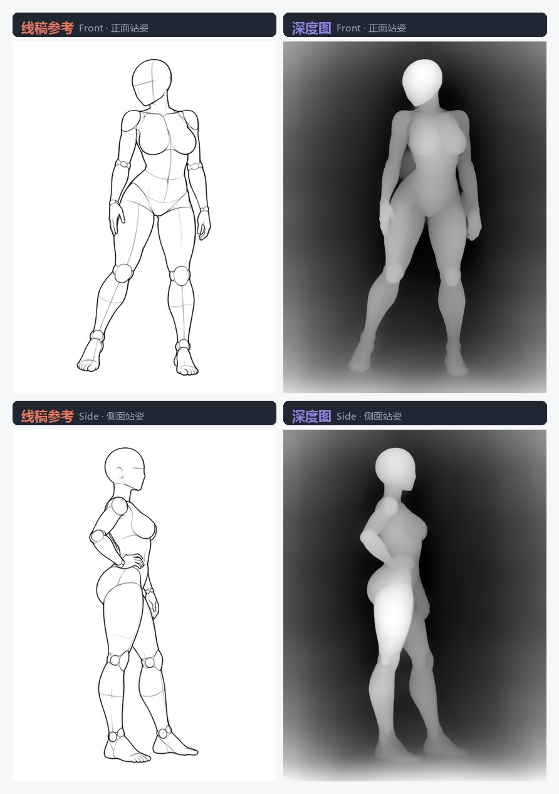
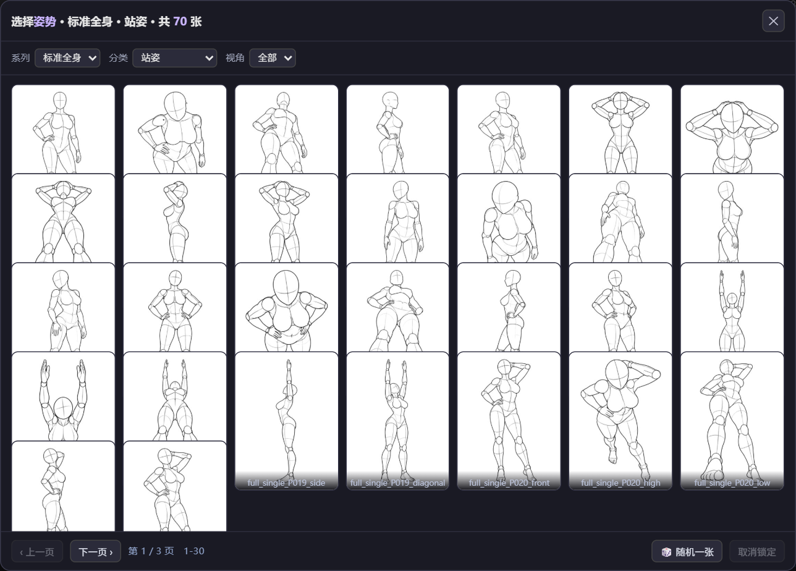
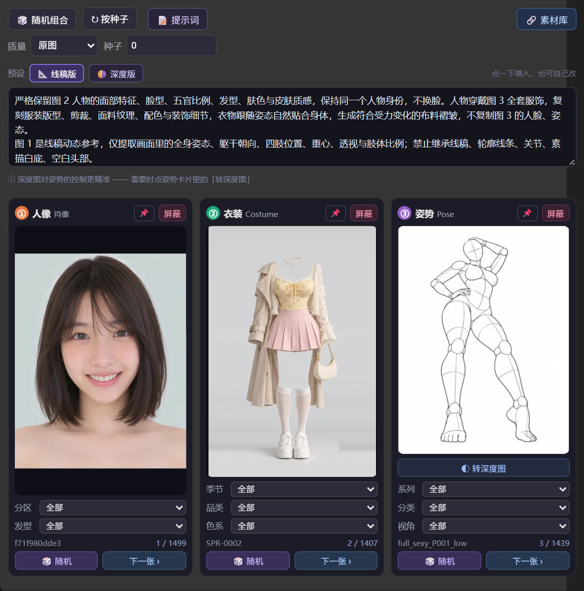

# ComfyUI RuiC PoseAtlas

把 [RuiC-PoseAtlas](https://github.com/HRuiCcc/RuiC-PoseAtlas) 素材库接成 ComfyUI 节点：一个节点同时输出**人像 / 衣装 / 姿势**三张参考图，适合喂给 Qwen-Image-Edit 这类多图编辑模型做「换人 + 换衣 + 摆姿势」。

带完整的可视化前端：三张卡片实时预览、点开卡片挑素材、单类随机、逐张翻页、子分类级联筛选、一键屏蔽，还能把姿势线稿一键转成**深度图**再送给模型。


一个节点输出的三张素材，分别对应「是谁」「穿什么」「什么姿势」：


三张图直接喂给 Qwen-Image-Edit 2.1，一次合成成品——脸来自人像图、衣服来自衣装图、姿势来自姿势图：


## 工作流接法


接线：**人像 → `image_1`，衣装 → `image_2`，姿势 → `image_3`**（也就是节点输出口从左到右的顺序）；`CLIPLoader` 的 type 选 `qwen_image`，`KSampler` 的 latent 接 `TextEncodeQwenImage21` 的 `latent` 输出。节点右侧的「提示词」口直接连文本编码器的 `prompt`。

出图画布尺寸取自第一张图，所以比例由**人像图**决定；姿势想更稳，点姿势卡片的「◐ 转深度图」再切「🌗 深度版」提示词。

## 姿势线稿 → 深度图（按张切换）



素材库里的姿势参考是**白底黑线的人偶线稿**：大片留白 + 细细的轮廓线。这种图喂给模型，空白区域很容易被当成身体的一部分，在侧面、高位、斜角这些视角上尤其容易跑偏。

**姿势卡片里有一个「◐ 转深度图」按钮**。点它，节点就会把**当前这一张**姿势换成深度图再送给模型：

- **只影响当前这张**。换一张姿势（随机 / 下一张 / 点选 / 改种子）会自动恢复成线稿，不会一股脑全转；
- 再点一次按钮即还原线稿；
- 用的是 **DepthAnything V2 Small**（真实单目深度模型），深度图尺寸与原图完全一致，出图画布和 latent 尺寸都不变；
- **第一次点会弹提示**：需要下载约 95MB 的模型文件，从魔搭 ModelScope（国内可直连）下载到插件自己的 `.cache/models`，只需下这一次。点「取消」就不会下载；
- 没装 `comfyui_controlnet_aux` 时，节点会自动退回内置的轻量体积图（纯 CPU 形态学运算，零依赖，效果略差），并在 `信息` 端口标注「深度图（内置）」；两者都转不出来时保持线稿，标注「深度图已跳过」，不会输出黑图。

## 特性

- **三类素材一次取齐**：人像、衣装、姿势各输出一张 `IMAGE`，另附说明文字与自动拼好的提示词。
- **两种选图方式并存**：按种子确定性选取（可复现），或在卡片上手动锁定某一张。
- **点卡片直接挑素材**：点卡片里的预览图弹出选择器，按当前分类筛选、缩略图网格翻页，点一下就锁定，不用再回来翻「下一张」。
- **子分类级联**：下拉里只出现「当前其它条件筛完还剩素材」的选项。选了「标准全身」就不会再冒出一堆只有「性感全身」才有的分类。
- **姿势按张转深度图**：白底黑线的人偶线稿在侧面、高位、斜角这些视角上常常跟不住，点姿势卡片里的「◐ 转深度图」，这一张就会用 DepthAnything V2 转成深度图再送模型。只影响当前这张，换图自动还原。
- **两版提示词预设**：面板里内置「线稿版 / 深度版」两套模板，点一下直接填入，也可以完全自己写。
- **预览即出图**：前端锁定哪张，后端就出哪张，不会出现「预览和出图不一致」。
- **国内可直连**：不走 GitHub Pages 单点，内置 jsDelivr 等多条 CDN 线路，直连失败自动切代理，全部失败时用本地缓存兜底。
- **缓存加速**：素材索引和图片缓存在插件目录 `.cache/`，第二次起明显变快，可随时删除。

## 安装

### 方式一：ComfyUI Manager（推荐）

在 Manager 的 **Install via Git URL** 中填入本仓库地址：

```
https://github.com/shutong-queyue/ComfyUI-RuiC-PoseAtlas
```

### 方式二：git clone

```bash
cd ComfyUI/custom_nodes
git clone https://github.com/shutong-queyue/ComfyUI-RuiC-PoseAtlas.git
```

### 方式三：下载 zip

在仓库页面点绿色的 `Code` → `Download ZIP`，解压后把整个文件夹放进 `ComfyUI/custom_nodes/`（放进去后，该目录里应当能直接看到 `__init__.py`，别多套一层文件夹），然后重启 ComfyUI。

无论哪种方式，重启后在节点列表里搜 **三图组合** 或 **RuiC**。

依赖只有 `pillow` 和 `numpy`，ComfyUI 环境通常已自带。

「转深度图」是**软依赖**，按这个顺序降级，任何一环缺失都不影响出图：

1. 装了 `comfyui_controlnet_aux` + 有权重 → 用 DepthAnything V2 Small 生成深度图（`信息` 里标注「深度图（DA）」）；
2. 有权重但没有 aux → 退回内置体积图（`信息` 里标注「深度图（内置）」，纯 CPU 形态学运算，用到 `opencv`）；
3. 两者都没有 → 保持线稿，标注「深度图已跳过」。

## 使用

节点位于 `RuiC/三图组合` 分类，完整名称「三图组合 · RuiC 图鉴」。

### 输入参数

| 参数 | 说明 |
|---|---|
| 质量 | **在节点顶栏下拉选择**，默认 `原图`，输出素材真实分辨率（如人像 1122×1402、衣装 1366×2048、姿势 900×1200）；`缩略图` 仅约 400×500，只建议拿来快速试参 |
| 随机种子 | 关闭「每次随机」时，按此值确定性选图，同一种子结果固定 |
| 每次随机 | 开启后每次排队都重新抽样（与前端「随机组合」按钮等价） |
| 启用_人像 / 衣装 / 姿势 | 关闭即「屏蔽」该类，该路输出 1×1 占位图，不参与后续计算 |
| 人像_选定ID / 衣装_选定ID / 姿势_选定ID | 留空 = 按筛选 + 种子选取；填入 ID 则强制锁定该图。前端点卡片会自动写入 |
| 人像_分区 / 人像_发型 | 人像子分类筛选 |
| 衣装_季节 / 衣装_品类 / 衣装_色系 | 衣装子分类筛选 |
| 姿势_系列 / 姿势_分类 / 姿势_视角 | 姿势子分类筛选 |
| 姿势深度ID | 存的是「要转成深度图的那一张姿势的 ID」，空 = 全部输出线稿。前端点姿势卡片的「转深度图」会自动写入，换图时自动清空 |
| 提示词模板 | 提示词模板，右侧「提示词」口输出填好的结果，直接连文本编码器。支持占位符：`{姿势描述}` = 姿势名（分类：身体状态），`{姿势}` = 只取姿势名；不用占位符也完全没问题 |

### 输出

| 端口 | 类型 | 说明 |
|---|---|---|
| 人像 | IMAGE | 人像参考图 |
| 衣装 | IMAGE | 衣装参考图 |
| 姿势 | IMAGE | 姿势参考图（点了「转深度图」时是深度图） |
| 信息 | STRING | 三张图的 ID、名称、实际像素尺寸，便于核对 |
| 提示词 | STRING | 按模板填好的完整提示词，连 `TextEncodeQwenImage21` 的 `prompt` |

### 前端面板操作

节点上的原生参数控件被卡片面板接管并隐藏，因此**质量、种子、屏蔽开关、子分类筛选、深度图开关都在面板里操作**：

- `质量` / `种子`：顶栏第二行两个控件，等价于被隐藏的原生参数。下拉里显示的就是实际提交的值，读档后会跟着存档对齐。
- `◐ 转深度图`：**姿势卡片专属**。点一下把当前这一张换成深度图，只影响这张；再点一下还原。换图（随机 / 下一张 / 点选 / 改种子）会自动恢复线稿。
- `点预览图`：在弹窗里挑素材。可按当前分类筛选、翻页，点一下就锁定并关闭；底部还有「随机一张」「取消锁定」。
- `📌`：卡片标题右侧，亮起表示已锁定某一张。点一下取消锁定，回到「按种子随机」。
- `🎲 随机`：在当前所选子分类范围内，只随机这一类，不动另外两类。
- `下一张 ›`：跳到同维度下一张，到底回绕，进度显示 `当前 / 总数`。
- `屏蔽`：该类别不出图，进度显示 `—`。
- `📝 提示词`：展开提示词编辑框。里面有两个预设按钮：`📐 线稿版`、`🌗 深度版`，点一下直接填入，也可以完全自己写；改完实时写回节点参数。
- `🔗 素材库`：在浏览器打开上游素材库，方便先挑素材。
- `随机组合` / `按种子`：前者不可复现，后者按「随机种子」数值确定性取图，可复现。

点卡片里的预览图，会按当前分区弹出选择器，缩略图网格翻页、点一下就锁定：



## 提示词：先用预设



展开面板里的 `📝 提示词`，两版预设点一下直接填入（**图 1 = 人像，图 2 = 衣装，图 3 = 姿势**）：

- **`📐 线稿版`**：把图 3 当纯动态参考，只取姿态 / 朝向 / 重心 / 肢体比例，禁止继承线条、关节、白底与空白头部；适合直接用线稿当姿态参考。
- **`🌗 深度版`**：把图 3 说成「深度图与姿态结构参考」，只取动作结构，明确不继承人物身份 / 脸部 / 服装 / 背景。配合「转深度图」用。

**一般直接用预设就够了。** 出图有偏差，先微调预设里的那两句（比如表情、服装细节）；姿势跟不住就点姿势卡片的「◐ 转深度图」再切到「深度版」——深度图对姿势的控制更精准，侧面 / 高位 / 斜角优先试它。

## 缓存与离线

- 索引 JSON 与图片存放于 `插件目录/.cache/`，索引有效期 7 天。
- 缓存目录可随时删除，下次运行会自动重建。
- 若所在网络完全无法访问素材站，插件会给出明确日志并以 1×1 占位图收场，不会让整个工作流报错中断。

## 常见问题

**出图全是 1×1？**
看控制台日志：如果提示「素材池为空」，是索引没拉到，检查网络后重启 ComfyUI；如果提示「选定ID未找到」，是前端锁定的 ID 来自更新的素材库版本，重启后端刷新缓存即可。

**出图尺寸只有 400×500 左右？**
「质量」被设成了 `缩略图`。切回 `原图` 即可。节点输出的 `信息` 端口会写明每张图的实际像素尺寸，可直接核对。

**姿势跟不住（永远站姿 / 不按参考摆）？**
先点姿势卡片的「◐ 转深度图」，把提示词切成「🌗 深度版」再跑——深度图对姿态的控制最稳。还是不稳的话，看衣装图是不是完整的站姿人台，预设里那句「不复制图 2 的人脸、姿态」要留着。

**点了「转深度图」没反应 / 弹窗提示缺模型？**
第一次点会问你要不要下载约 95MB 的 DepthAnything V2 Small（从魔搭下载，国内可直连）。点「取消」就不会下。
如果提示「缺依赖」：本机没装 `comfyui_controlnet_aux`，装上即可；不装也行，会继续用内置体积图。
如果提示「下载失败」：换个网络重试，或手动把 `depth_anything_v2_vits.pth` 放到 `插件目录/.cache/models/` 下再点一次。

**转出来的深度图偶尔还是线稿？**
少数视角的线稿轮廓本身是断的（手臂压在躯干前、斜角构图），内置体积图算法补不出完整人体区域，这时会保持原线稿并在 `信息` 标注「深度图已跳过」，不会输出黑图。用 DA 模型则几乎不会出现。

**卡片面板不显示 / 不随节点缩放？**
浏览器硬刷新（Ctrl+F5）一次，确保加载到最新前端脚本。

**预览图和实际出图不一致？**
正常情况不会。若出现，多半是改完素材库后没重启，重启 ComfyUI 后缓存与新索引会对齐。

## 素材来源与授权

本仓库**只包含加载器代码，不包含任何图片素材**。素材由 [HRuiCcc/RuiC-PoseAtlas](https://github.com/HRuiCcc/RuiC-PoseAtlas) 提供，版权归原作者所有，使用时请遵守该仓库的条款。若上游地址或授权发生变化，本插件可能需要相应调整。

插件代码以 MIT 协议开源，详见 `LICENSE`。
